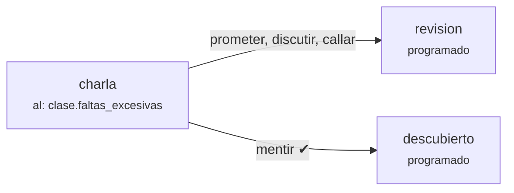
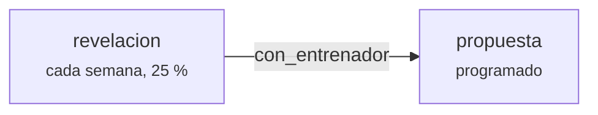
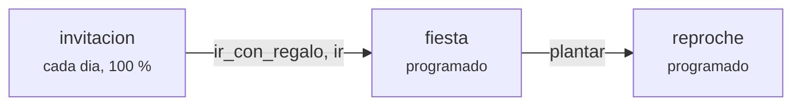

# Mapa de los eventos

Generado con `npm run eventos:mapa`. Cada hilo, con sus sucesos (las flechas son «programa»), y las marcas con que los hilos se hablan entre sí.

## Eventos base

### Las faltas llegan a casa (`eventos.familia.faltas`)

### Pulmones grandes (`eventos.perks.pulmones`)

### El cumpleaños de un amigo (`eventos.relaciones.cumple`)

### Sucesos sueltos

| Suceso | Título | Disparo | Categoría |
|---|---|---|---|
| `eventos.colegio.pregunta_del_profesor` | Te preguntan a ti | al: `clase.asistida` | menor |
| `eventos.colegio.companero_pide_ayuda` | Te piden ayuda | al: `clase.asistida` | menor |
| `eventos.colegio.nota_por_la_clase` | Una nota que pasa de mesa en mesa | al: `clase.asistida` | menor |
| `eventos.colegio.dia_de_lluvia` | Llueve a mares | al: `clase.asistida` | menor |
| `eventos.colegio.balon_perdido` | Un balón que viene hacia ti | al: `lugares.llegada` | menor |
| `eventos.colegio.juego_nuevo` | Un juego nuevo en el patio | al: `lugares.llegada` | menor |
| `eventos.colegio.pique_en_el_patio` | Un pique | al: `lugares.llegada` | menor |
| `eventos.colegio.sol_en_el_patio` | Un rato al sol | al: `lugares.llegada` | menor |
| `eventos.cuerpo.bajito` | Un comentario sobre tu altura | cada dia, 8 % | menor |
| `eventos.cuerpo.alto` | Un comentario sobre tu altura | cada dia, 8 % | menor |
| `eventos.estudios.primer_dia_de_educacion_fisica` | Tu primera clase de Educación física | al: `clase.asistida` | importante |
| `eventos.estudios.tarde_a_clase` | Llegas tarde a clase | al: `clase.asistida` | importante |
| `eventos.perks.asmatico` | Te falta el aire | al: `accion.realizada` | importante |
| `eventos.perks.vision_periferica` | Lo ves todo | cada semana, 15 % | importante |
| `eventos.perks.miope` | La pizarra, borrosa | cada semana, 15 % | importante |
| `eventos.perks.recuperacion_rapida` | Al día siguiente, como nuev{yo:o/a} | cada semana, 15 % | importante |
| `eventos.perks.recuperacion_lenta` | Te cuesta recuperarte | cada semana, 15 % | importante |
| `eventos.perks.reflejos_felinos` | Lo has cogido al vuelo | cada semana, 15 % | importante |
| `eventos.perks.torpe` | Siempre un segundo tarde | cada semana, 15 % | importante |
| `eventos.perks.equilibrio_natural` | No hay quien te tire | cada semana, 15 % | importante |
| `eventos.perks.desequilibrado` | Otra vez al suelo | cada semana, 15 % | importante |
| `eventos.perks.memoria_motora_fotografica` | Con verlo una vez te basta | cada semana, 15 % | importante |
| `eventos.perks.memoria_motora_corta` | Lo que aprendes se te va | cada semana, 15 % | importante |
| `eventos.perks.sangre_fria` | Cuando más aprieta, mejor estás | al: `competicion.resultado` | importante |
| `eventos.perks.nervioso` | Los nervios te pueden | al: `competicion.resultado` | importante |
| `eventos.perks.suertudo` | Qué suerte tienes | cada semana, 4 % | importante |
| `eventos.perks.gafe` | Qué mala pata | cada semana, 4 % | importante |
| `eventos.perks.gigante` | Otra vez te quedan cortos los pantalones | cada semana, 10 % | importante |
| `eventos.perks.enano` | Los demás han pegado el estirón | cada semana, 10 % | importante |
| `eventos.salud.lesion` | Una lesión | al: `persona.lesion` | importante |

## Eventos deportivos

### Sucesos sueltos

| Suceso | Título | Disparo | Categoría |
|---|---|---|---|
| `futbol.primer_entrenamiento` | Tu primer entrenamiento | al: `accion.realizada` | importante |
| `futbol.tarde_al_entrenamiento` | Llegas tarde al entrenamiento | al: `club.sesion_tarde` | importante |
| `futbol.tarde_a_la_convocatoria` | Llegas tarde a la convocatoria | al: `club.impuntual` | importante |

## Marcas

| Marca | La pone | La lee |
|---|---|---|
| `futbol_quiere_cambiar_de_puesto` | `futbol.primer_entrenamiento` | — (todavía nadie) |
| `le_recomendaron_un_deporte` | `eventos.estudios.primer_dia_de_educacion_fisica` | — (todavía nadie) |
| `lesionado_hace_poco` | `eventos.salud.lesion` | — (todavía nadie) |
| `lleva_regalo` | `eventos.relaciones.cumple.invitacion` | `eventos.relaciones.cumple.fiesta` |
| `lo_pillaron_mintiendo_en_casa` | `eventos.familia.faltas.charla`, `eventos.familia.faltas.descubierto` | — (todavía nadie) |
| `mintio_a_sus_padres` | `eventos.familia.faltas.charla` | — (todavía nadie) |
| `planton` | `eventos.relaciones.cumple.fiesta` | `eventos.relaciones.cumple.invitacion` |
| `prometio_no_faltar` | `eventos.familia.faltas.charla` | `eventos.familia.faltas.revision` |
| `rompio_una_promesa_en_casa` | `eventos.familia.faltas.revision` | — (todavía nadie) |
