# Mapa de los eventos

Generado con `npm run eventos:mapa`. Cada hilo, con sus sucesos (las flechas son «programa»), y las marcas con que los hilos se hablan entre sí.

## Eventos base

### Dos amigos se pelean (`eventos.amigos.pelea`)

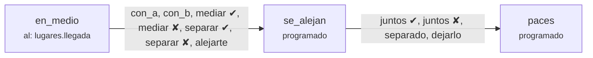

### Un préstamo entre amigos (`eventos.amigos.prestado`)

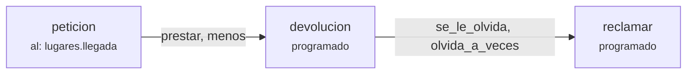

### Un secreto (`eventos.amigos.secreto`)

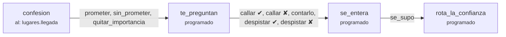

### Lo que quieres de verdad (`eventos.casa.ahorrar`)

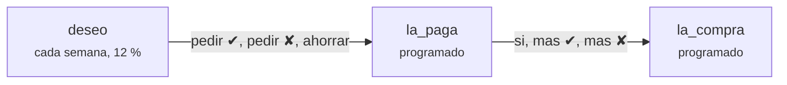

### Las notas de la evaluación (`eventos.casa.boletin`)

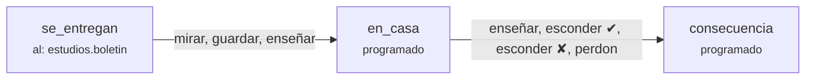

### Se oyen voces (`eventos.casa.padres_discuten`)

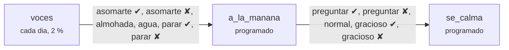

### Un mote (`eventos.colegio.apodo`)

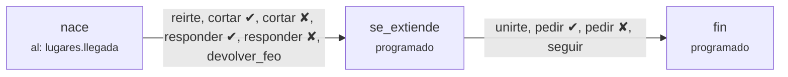

### Un compañero nuevo (`eventos.colegio.companero_nuevo`)

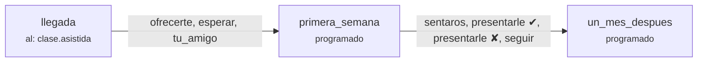

### Un examen (`eventos.colegio.examen`)

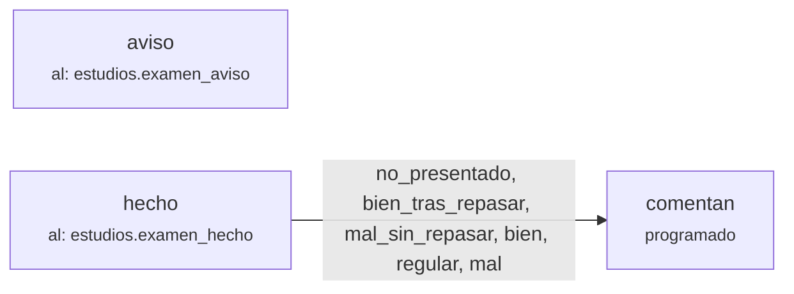

### El profesor se preocupa (`eventos.colegio.tutor_se_preocupa`)

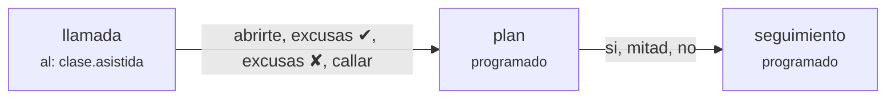

### Las faltas llegan a casa (`eventos.familia.faltas`)

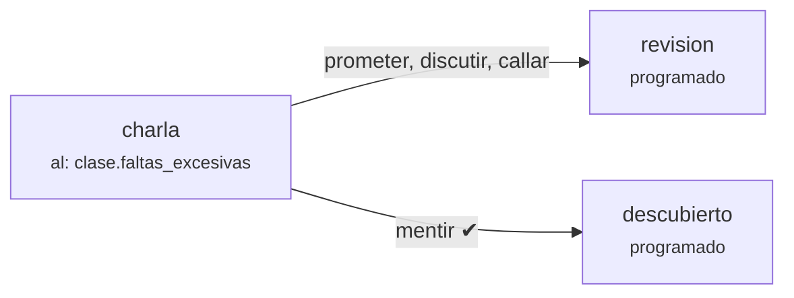

### Pulmones grandes (`eventos.perks.pulmones`)

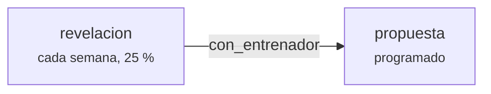

### El cumpleaños de un amigo (`eventos.relaciones.cumple`)

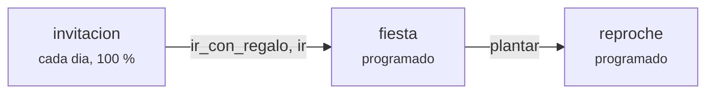

### Sucesos sueltos

| Suceso | Título | Disparo | Categoría |
|---|---|---|---|
| `eventos.amigos.regalo_inesperado` | Esto es para ti | al: `lugares.llegada` | menor |
| `eventos.amigos.apuesta_en_el_patio` | Te reto | al: `lugares.llegada` | menor |
| `eventos.amigos.un_amigo_de_un_amigo` | Te presento a… | al: `lugares.llegada` | menor |
| `eventos.amigos.amigo_que_se_enfria` | Hace días que no hablas | cada semana, 25 % | menor |
| `eventos.amigos.parque_partido` | Falta uno | al: `lugares.llegada` | menor |
| `eventos.barrio.perro_suelto` | Un perro suelto | al: `lugares.llegada` | menor |
| `eventos.barrio.musico_en_la_avenida` | Música en la avenida | al: `lugares.llegada` | menor |
| `eventos.barrio.moneda_en_la_acera` | Una moneda en la acera | al: `lugares.llegada` | menor |
| `eventos.camino.companero_de_camino` | Vais juntos al colegio | al: `lugares.llegada` | menor |
| `eventos.camino.se_hace_tarde` | Se hace tarde | al: `lugares.llegada` | menor |
| `eventos.casa.ayudar_con_la_cena` | Hay que poner la mesa | al: `lugares.llegada` | menor |
| `eventos.casa.cena_favorita` | Tu plato favorito | al: `lugares.llegada` | menor |
| `eventos.casa.hermano_quiere_jugar` | Quiere jugar contigo | al: `lugares.llegada` | menor |
| `eventos.casa.noche_sin_sueno` | No te duermes | cada dia, 4 % | menor |
| `eventos.casa.desayuno` | El desayuno de las prisas | cada dia, 4 % | menor |
| `eventos.casa.deberes_con_padre` | ¿Y esos deberes? | al: `lugares.llegada` | menor |
| `eventos.casa.hermano_no_duerme` | Ruidos en el pasillo | cada dia, 3 % | menor |
| `eventos.casa.tele_con_el_hermano` | ¿Qué vemos? | al: `lugares.llegada` | menor |
| `eventos.casa.tarea_del_hogar` | Sábado de limpieza | cada dia, 25 % | menor |
| `eventos.casa.cena_de_domingo` | ¿Qué tal la semana? | cada dia, 30 % | menor |
| `eventos.casa.verano_aburrido` | Una tarde sin nada | cada dia, 12 % | menor |
| `eventos.colegio.pregunta_del_profesor` | Te preguntan a ti | al: `clase.asistida` | menor |
| `eventos.colegio.companero_pide_ayuda` | Te piden ayuda | al: `clase.asistida` | menor |
| `eventos.colegio.nota_por_la_clase` | Una nota que pasa de mesa en mesa | al: `clase.asistida` | menor |
| `eventos.colegio.dia_de_lluvia` | Llueve a mares | al: `clase.asistida` | menor |
| `eventos.colegio.rumor` | Dicen que… | al: `lugares.llegada` | menor |
| `eventos.colegio.salida_con_hermano` | Te espera en la puerta | al: `lugares.llegada` | menor |
| `eventos.colegio.en_la_puerta` | Ya están en la entrada | al: `lugares.llegada` | menor |
| `eventos.colegio.copiar_deberes` | ¿Me dejas los deberes? | al: `lugares.llegada` | menor |
| `eventos.colegio.capitan_de_equipo` | Hacen los equipos | al: `clase.asistida` | menor |
| `eventos.colegio.cambio_de_sitios` | Nuevos sitios | al: `lugares.llegada` | menor |
| `eventos.colegio.cabeceo_en_clase` | Los ojos se te cierran | al: `clase.asistida` | menor |
| `eventos.colegio.profesor_se_equivoca` | El profesor se equivoca | al: `clase.asistida` | menor |
| `eventos.colegio.trabajo_en_grupo` | Un trabajo en grupo | al: `clase.asistida` | menor |
| `eventos.colegio.cambio_de_cromos` | Cambio de cromos | al: `lugares.llegada` | menor |
| `eventos.colegio.solo_en_el_patio` | Alguien está solo | al: `lugares.llegada` | menor |
| `eventos.colegio.merienda_del_recreo` | La merienda del recreo | al: `lugares.llegada` | menor |
| `eventos.colegio.balon_perdido` | Un balón que viene hacia ti | al: `lugares.llegada` | menor |
| `eventos.colegio.juego_nuevo` | Un juego nuevo en el patio | al: `lugares.llegada` | menor |
| `eventos.colegio.pique_en_el_patio` | Un pique | al: `lugares.llegada` | menor |
| `eventos.colegio.sol_en_el_patio` | Un rato al sol | al: `lugares.llegada` | menor |
| `eventos.cuerpo.bajito` | Un comentario sobre tu altura | cada dia, 8 % | menor |
| `eventos.cuerpo.alto` | Un comentario sobre tu altura | cada dia, 8 % | menor |
| `eventos.estudios.primer_dia_de_educacion_fisica` | Tu primera clase de Educación física | al: `clase.asistida` | importante |
| `eventos.estudios.tarde_a_clase` | Llegas tarde a clase | al: `clase.asistida` | importante |
| `eventos.grupo.se_van` | Se van en grupo | al: `presencia.grupo_se_va` | importante |
| `eventos.perks.asmatico` | Te falta el aire | al: `accion.realizada` | importante |
| `eventos.perks.vision_periferica` | Lo ves todo | cada semana, 15 % | importante |
| `eventos.perks.miope` | La pizarra, borrosa | cada semana, 15 % | importante |
| `eventos.perks.recuperacion_rapida` | Al día siguiente, como nuev{yo:o/a} | cada semana, 15 % | importante |
| `eventos.perks.recuperacion_lenta` | Te cuesta recuperarte | cada semana, 15 % | importante |
| `eventos.perks.reflejos_felinos` | Lo has cogido al vuelo | cada semana, 15 % | importante |
| `eventos.perks.torpe` | Siempre un segundo tarde | cada semana, 15 % | importante |
| `eventos.perks.equilibrio_natural` | No hay quien te tire | cada semana, 15 % | importante |
| `eventos.perks.desequilibrado` | Otra vez al suelo | cada semana, 15 % | importante |
| `eventos.perks.memoria_motora_fotografica` | Con verlo una vez te basta | cada semana, 15 % | importante |
| `eventos.perks.memoria_motora_corta` | Lo que aprendes se te va | cada semana, 15 % | importante |
| `eventos.perks.sangre_fria` | Cuando más aprieta, mejor estás | al: `competicion.resultado` | importante |
| `eventos.perks.nervioso` | Los nervios te pueden | al: `competicion.resultado` | importante |
| `eventos.perks.suertudo` | Qué suerte tienes | cada semana, 4 % | importante |
| `eventos.perks.gafe` | Qué mala pata | cada semana, 4 % | importante |
| `eventos.perks.gigante` | Otra vez te quedan cortos los pantalones | cada semana, 10 % | importante |
| `eventos.perks.enano` | Los demás han pegado el estirón | cada semana, 10 % | importante |
| `eventos.salud.lesion` | Una lesión | al: `persona.lesion` | importante |

## Eventos deportivos

### Sucesos sueltos

| Suceso | Título | Disparo | Categoría |
|---|---|---|---|
| `atletismo.tarde_al_entrenamiento` | Llegas tarde al entrenamiento | al: `club.sesion_tarde` | importante |
| `futbol.primer_entrenamiento` | Tu primer entrenamiento | al: `accion.realizada` | importante |
| `futbol.tarde_al_entrenamiento` | Llegas tarde al entrenamiento | al: `club.sesion_tarde` | importante |
| `futbol.tarde_a_la_convocatoria` | Llegas tarde a la convocatoria | al: `club.impuntual` | importante |
| `futbol.prueba_de_acceso` | La prueba en el club | al: `club.prueba_empieza` | importante |
| `futbol.pedir_puesto` | Pedirle a {entrenador.nombre} jugar de {señal.puestoNombre} | al: `club.pide_puesto` | importante |
| `futbol.plaza_extra` | Una plaza de más en el equipo | al: `club.plaza_extra` | importante |
| `futbol.equipo_sin_ninos` | Tu equipo no sale este año | al: `club.equipo_sin_ninos` | importante |
| `futbol.plaza_perdida` | Te quedas sin plaza en el equipo | al: `club.plaza_perdida` | importante |

## Marcas

| Marca | La pone | La lee |
|---|---|---|
| `acepto_el_mote` | `eventos.colegio.apodo.nace` | `eventos.colegio.apodo.se_extiende`, `eventos.colegio.apodo.fin` |
| `bien_en_examen` | `eventos.colegio.examen.hecho` | `eventos.colegio.examen.comentan` |
| `conto_el_secreto` | `eventos.amigos.secreto.te_preguntan` | `eventos.amigos.secreto.se_entera` |
| `futbol_quiere_cambiar_de_puesto` | `futbol.primer_entrenamiento` | — (todavía nadie) |
| `guardo_el_secreto` | `eventos.amigos.secreto.se_entera` | `eventos.amigos.prestado.peticion` |
| `hablo_con_su_tutor` | `eventos.casa.padres_discuten.a_la_manana` | `eventos.casa.padres_discuten.se_calma` |
| `hizo_de_mediador` | `eventos.amigos.pelea.en_medio` | `eventos.amigos.pelea.se_alejan` |
| `ignoro_a_nuevo` | `eventos.colegio.companero_nuevo.llegada` | `eventos.colegio.companero_nuevo.primera_semana` |
| `junto_a_los_dos` | `eventos.amigos.pelea.se_alejan` | `eventos.amigos.pelea.paces` |
| `le_recomendaron_un_deporte` | `eventos.estudios.primer_dia_de_educacion_fisica` | — (todavía nadie) |
| `lesionado_hace_poco` | `eventos.salud.lesion` | `eventos.casa.cena_de_domingo` |
| `levanto_la_nota` | `eventos.colegio.tutor_se_preocupa.seguimiento` | `eventos.casa.cena_de_domingo` |
| `lleva_regalo` | `eventos.relaciones.cumple.invitacion` | `eventos.relaciones.cumple.fiesta` |
| `lo_pillaron_mintiendo_en_casa` | `eventos.casa.boletin.en_casa`, `eventos.familia.faltas.charla`, `eventos.familia.faltas.descubierto` | `eventos.casa.cena_de_domingo`, `eventos.casa.padres_discuten.voces` |
| `mal_en_examen` | `eventos.colegio.examen.hecho` | `eventos.colegio.examen.comentan` |
| `mintio_a_sus_padres` | `eventos.casa.deberes_con_padre`, `eventos.familia.faltas.charla` | `eventos.casa.cena_de_domingo` |
| `no_estudio_para_el_examen` | `eventos.colegio.examen.aviso` | `eventos.colegio.examen.hecho` |
| `perdono_una_deuda` | `eventos.amigos.prestado.reclamar` | `eventos.amigos.regalo_inesperado` |
| `planton` | `eventos.relaciones.cumple.fiesta` | `eventos.relaciones.cumple.invitacion` |
| `presto_poco` | `eventos.amigos.prestado.peticion` | `eventos.amigos.prestado.devolucion`, `eventos.amigos.prestado.reclamar` |
| `prometio_no_faltar` | `eventos.familia.faltas.charla` | `eventos.familia.faltas.revision` |
| `repaso_a_fondo` | `eventos.colegio.examen.aviso` | `eventos.colegio.examen.hecho` |
| `rompio_una_promesa_en_casa` | `eventos.familia.faltas.revision` | `eventos.casa.boletin.en_casa`, `eventos.casa.deberes_con_padre`, `eventos.casa.cena_de_domingo` |
| `se_acerco_a_sus_padres` | `eventos.casa.padres_discuten.voces` | `eventos.casa.padres_discuten.a_la_manana` |
| `se_sospecha` | `eventos.amigos.secreto.te_preguntan` | `eventos.amigos.secreto.se_entera` |
| `sento_a_nuevo` | `eventos.colegio.companero_nuevo.llegada` | `eventos.colegio.companero_nuevo.primera_semana` |
| `tomo_partido` | `eventos.amigos.pelea.en_medio` | `eventos.amigos.pelea.se_alejan`, `eventos.amigos.pelea.paces` |
| `vecino_de_mesa` | `eventos.colegio.cambio_de_sitios` | `eventos.colegio.copiar_deberes` |
